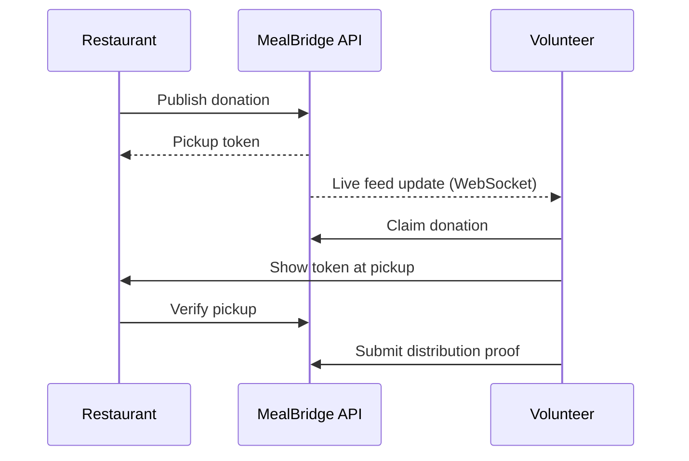

<div align="center">

# 🍽️ MealBridge

**Bridging the gap between surplus food and the people who need it.**

MealBridge connects restaurants with volunteer organizations so leftover food gets
collected and distributed instead of thrown away, with real-time updates,
pickup-token verification, and ML-powered waste forecasts.


</div>

---

## ✨ Features

- 🏪 **Restaurants** publish surplus food with quantity, description, and a validity window.
- 🤝 **Volunteers** browse a live feed, claim donations, and collect them on time.
- 🔐 **Pickup tokens** (QR-friendly) verify that the right volunteer collected the right food.
- 📸 **Proof of distribution** via photo upload, or a photo-free confirmation.
- 📍 **Geospatial search** finds nearby restaurants using PostGIS.
- ⚡ **Real-time updates** over WebSocket (STOMP + SockJS).
- ⏱️ **Auto-expiry**: a scheduler expires stale donations every minute, with a 1-hour grace period for claimed or picked-up items.
- 📊 **Analytics dashboards** for admins, restaurants, and volunteers.
- 🤖 **Waste prediction**: a Random Forest model forecasts tomorrow's surplus per restaurant.
- 🛡️ **Secure by default**: JWT auth, token blacklist on logout, password reset by email, and admin approval of new volunteer groups.

## 🔄 How It Works



Donation lifecycle:

```text
AVAILABLE ──► CLAIMED ──► PICKED_UP ──► DISTRIBUTED
    │            │            │
    └────────────┴────────────┴──────► EXPIRED (automatic)
```

## 🏗️ Architecture

| Layer | Technology |
| --- | --- |
| API | Spring Boot 3.5, Java 21, Spring Web, Data JPA, Security, Validation, Mail |
| Auth | JWT (jjwt) with token blacklist |
| Realtime | Spring WebSocket, STOMP broker at `/topic`, endpoint `/ws` |
| Database | PostgreSQL 15 + PostGIS (Hibernate Spatial) |
| ML service | Flask + scikit-learn `RandomForestRegressor` |
| Storage | Local `uploads/` directory for proof images |
| Deployment | Docker Compose: API, ML service, database, Watchtower |
| CI/CD | GitHub Actions builds and pushes Docker images on every push to `main` |

## 🚀 Quick Start

### Option 1: Docker Compose (recommended)

Requires Docker Desktop with Compose.

```bash
docker compose up -d
```

| Service | URL |
| --- | --- |
| Spring Boot API | http://localhost:8080 |
| ML service | http://localhost:5000 |
| PostgreSQL/PostGIS | `localhost:5432` |

```bash
docker compose logs -f api   # follow API logs
docker compose down          # stop the stack
```

> The Compose file pulls the published images `pinsara23/meal-bridge` and `pinsara23/meal-bridge-ml`.
> To build from source, build the images locally or replace `image:` with `build:` definitions.

### Option 2: Run locally

**Prerequisites:** Java 21, PostgreSQL 15+ with PostGIS, Python 3.9+ (for the ML service).

1. Create a PostgreSQL database named `MealBridge` and enable PostGIS:
   ```sql
   CREATE EXTENSION IF NOT EXISTS postgis;
   ```
2. Set the datasource and mail settings in `src/main/resources/application.properties` (or override them with environment variables).
3. Start the API:
   ```bash
   ./mvnw spring-boot:run          # macOS / Linux
   .\mvnw.cmd spring-boot:run      # Windows
   ```
4. Start the ML service:
   ```bash
   cd ML_Model
   python -m venv .venv
   source .venv/bin/activate       # Windows: .\.venv\Scripts\Activate.ps1
   pip install -r requirements.txt
   python MealBridgeMLModel.py
   ```
5. Run the tests:
   ```bash
   ./mvnw test
   ```

## ⚙️ Configuration

| Variable | Purpose | Default |
| --- | --- | --- |
| `SPRING_DATASOURCE_URL` | JDBC URL | `jdbc:postgresql://localhost:5432/MealBridge` |
| `SPRING_DATASOURCE_USERNAME` | Database user | `postgres` |
| `SPRING_DATASOURCE_PASSWORD` | Database password | *(set yours)* |
| `SPRING_JPA_HIBERNATE_DDL_AUTO` | Schema strategy | `update` |
| `ML_API_URL` | Prediction service URL | `http://localhost:5000/predict` |
| `SPRING_MAIL_USERNAME` / `SPRING_MAIL_PASSWORD` | SMTP credentials for password reset | *(set yours)* |

> ⚠️ Never commit database passwords, SMTP passwords, or JWT secrets. Use environment variables or a secret manager,
> and replace every development value in `docker-compose.yaml` and `application.properties` before deploying.
> For production, prefer database migrations over `ddl-auto=update`.

## 🔑 Authentication

Log in at `POST /api/auth/login` and send the returned JWT with protected requests:

```http
Authorization: Bearer <JWT>
```

```json
{ "email": "restaurant@example.com", "password": "your-password" }
```

Restaurants and volunteers log in with their email. Admins use their username in the same `email` field.
Registration, login, and password-reset endpoints are public; everything else needs a token.

## 📡 API Reference

All routes are relative to `http://localhost:8080`.

<details>
<summary><b>Auth</b> · <code>/api/auth</code></summary>

| Method | Endpoint | Description |
| --- | --- | --- |
| POST | `/login` | Obtain a JWT |
| POST | `/forgot-password` | Email a reset link |
| POST | `/reset-password` | Set a new password |
| POST | `/logout` | Blacklist the current token |

</details>

<details>
<summary><b>Restaurants</b> · <code>/api/restaurants</code></summary>

| Method | Endpoint | Description |
| --- | --- | --- |
| POST | `/register` | Register a restaurant |
| PUT | `/update/{restaurantId}` | Update profile |
| POST | `/update/password/{restaurantId}` | Change password |
| GET | `/nearby?latitude=&longitude=&radius=` | Find restaurants within a radius (meters) |
| GET | `/details/{id}` | Restaurant details |
| GET | `/location/{id}` | Restaurant location |

```json
{
  "businessName": "Example Kitchen",
  "email": "restaurant@example.com",
  "password": "change-me",
  "phoneNumber": "0771234567",
  "latitude": 6.847114,
  "longitude": 79.946669,
  "openTime": "08:00:00",
  "closeTime": "22:00:00"
}
```

</details>

<details>
<summary><b>Volunteers</b> · <code>/api/volunteer</code></summary>

| Method | Endpoint | Description |
| --- | --- | --- |
| POST | `/register` | Register a volunteer group (needs admin approval) |
| PUT | `/update/{id}` | Update profile |
| POST | `/update/password/{id}` | Change password |
| GET | `/details/{id}` | Volunteer details |

```json
{
  "presidentFullName": "Volunteer Coordinator",
  "organizationName": "Community Helpers",
  "email": "volunteers@example.com",
  "phoneNumber": "0716585486",
  "password": "change-me"
}
```

</details>

<details>
<summary><b>Donations</b> · <code>/api/donations</code></summary>

| Method | Endpoint | Description |
| --- | --- | --- |
| POST | `/` | Publish a donation and generate a pickup token |
| GET | `/feed` | Available donations |
| GET | `/feed/restaurent/{id}` | A restaurant's donations |
| GET | `/feed/history/restaurant/{id}` | Restaurant donation history |
| GET | `/feed/volunteer/{id}` | Donations assigned to a volunteer |
| GET | `/feed/finish/volunteer/{id}` | A volunteer's completed donations |
| PUT | `/{donationId}/claim?vId=` | Claim a donation |
| PUT | `/{id}/verify-pickup?token=` | Verify collection |
| POST | `/distribute` | Submit distribution proof (multipart) |
| POST | `/distribute/withoutphoto?token=` | Confirm distribution without a photo |
| GET | `/{id}/image` | Retrieve proof image |

```json
{
  "foodDescription": "10 packets of rice and curry",
  "quantityKg": 3.5,
  "hoursValid": 4,
  "restaurantId": 1
}
```

</details>

<details>
<summary><b>Admin</b> · <code>/api/admin</code> (admin JWT required)</summary>

| Method | Endpoint | Description |
| --- | --- | --- |
| POST | `/register` | Register an admin |
| PUT | `/volunteer/{id}/approve` | Approve a volunteer group |
| GET | `/stats/tot-restaurants` · `/tot-volunteers` | User totals |
| GET | `/stats/tot-donations` · `/available` · `/completed` | Donation totals |
| GET | `/stats/tot-quantity` | Total food quantity |
| GET | `/stats/users/count` | User counts |
| GET | `/stats/restaurants` · `/volunteers` | Listings |
| GET | `/stats/volunteers/unapproved` | Pending approvals |

</details>

<details>
<summary><b>Analytics</b> · <code>/api/analytic</code></summary>

| Method | Endpoint | Description |
| --- | --- | --- |
| GET | `/graph/distributed/{id}` · `/graph/expired/{id}` · `/graph/all/{id}` | Donation status graphs |
| GET | `/donations/month/restaurant/{id}` | Monthly donations (restaurant) |
| GET | `/donations/count/{month,total,aval}/restaurant/{id}` | Restaurant counters |
| GET | `/donations/count/{month,total,aval,finish}/volunteer/{id}` | Volunteer counters |
| GET | `/creditor/volunteer/{id}` | Volunteer credit data |
| GET | `/predict/{restaurantId}` | Predicted surplus for tomorrow |

</details>

### Real-time channel

Connect to `http://localhost:8080/ws` (SockJS) and subscribe to `/topic/**` destinations to receive donation and volunteer events live.

## 🤖 ML Service

`POST /predict` accepts historical records and returns tomorrow's predicted surplus in kg.

```json
[
  { "dayIndex": 0, "totalWeight": 2.5 },
  { "dayIndex": 1, "totalWeight": 3.1 },
  { "dayIndex": 2, "totalWeight": 2.8 }
]
```

```json
{ "status": "success", "predictedQuantity": 2.8, "message": "Predicted waste for tomorrow: 2.8 kg" }
```

The API reaches this service through the `ML_API_URL` property.

## 📁 Project Structure

```text
MealBridge/
├── src/main/java/org/se/mealbridge/
│   ├── configs/        Security, WebSocket, mapper, exception handling
│   ├── controller/     REST controllers
│   ├── dto/            Request/response models
│   ├── entity/         JPA entities
│   ├── repository/     Spring Data repositories
│   ├── scheduler/      Donation expiry job
│   ├── security/       JWT filter and utilities
│   ├── services/       Business logic
│   └── util/           File storage helper
├── ML_Model/           Flask prediction service
├── uploads/            Donation proof images
├── .github/workflows/  CI/CD pipeline
├── Dockerfile          API image
├── docker-compose.yaml Full deployment stack
└── pom.xml             Maven build
```

## 🚢 CI/CD

Every push to `main` triggers a GitHub Actions workflow that builds the API and ML images and pushes them to Docker Hub.
Watchtower on the host then pulls the new images and restarts the containers automatically.

## 📄 License

No license has been specified yet. Add a `LICENSE` file to define how others may use this project.
